# BAGHOLDERS

**Everyone shares the bag.** A first-person, 1–6 player trading floor game for you and your friends.
You're a desk of degenerate traders at a hedge fund. Everyone trades from **one shared fund**, you have
**5 minutes a day** to hit a **profit quota that keeps going up**, and if you get too greedy, **the cops
come out of the elevator.**

Inspired by the *Broke Street* trailer (see [`docs/VIDEO_BREAKDOWN.md`](docs/VIDEO_BREAKDOWN.md)).
Built in **Godot 4.7** — free, no accounts, no store.

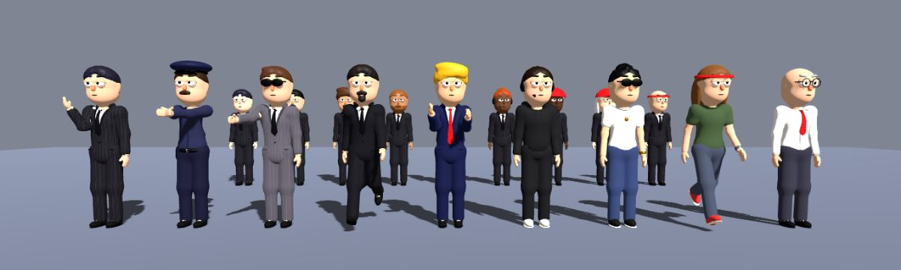

| | |
|---|---|
| 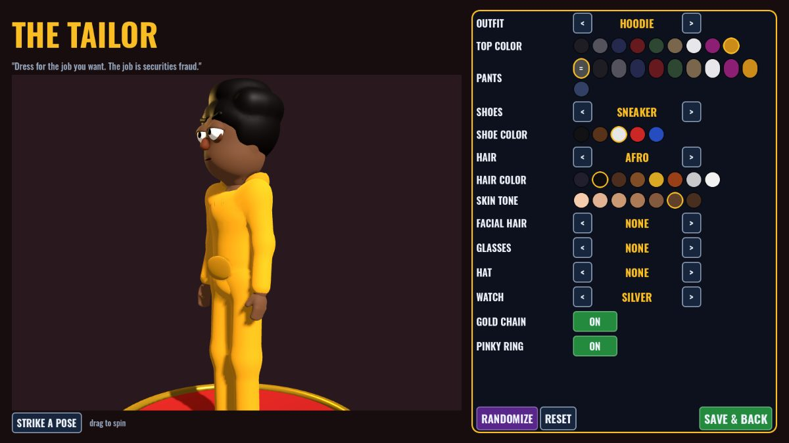 | 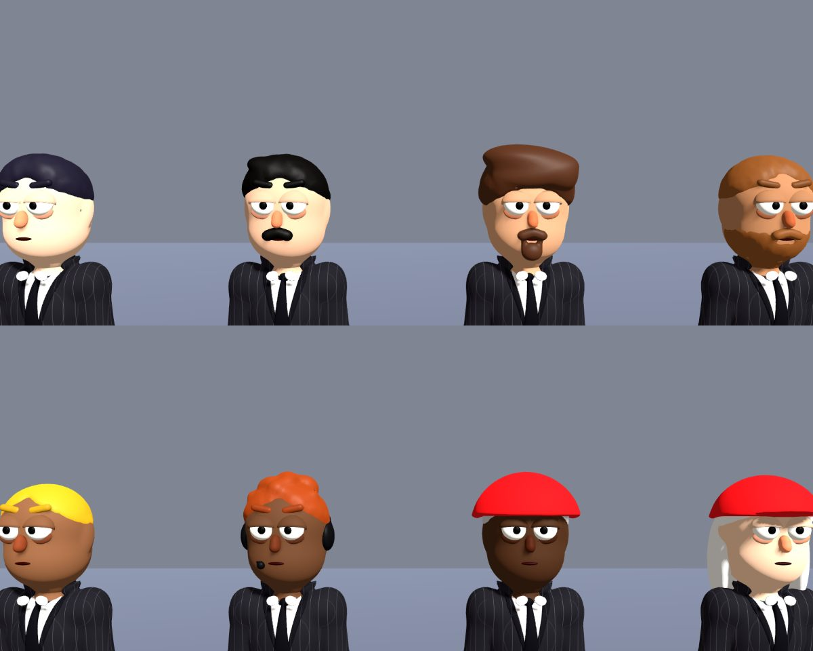 |

| | |
|---|---|
| 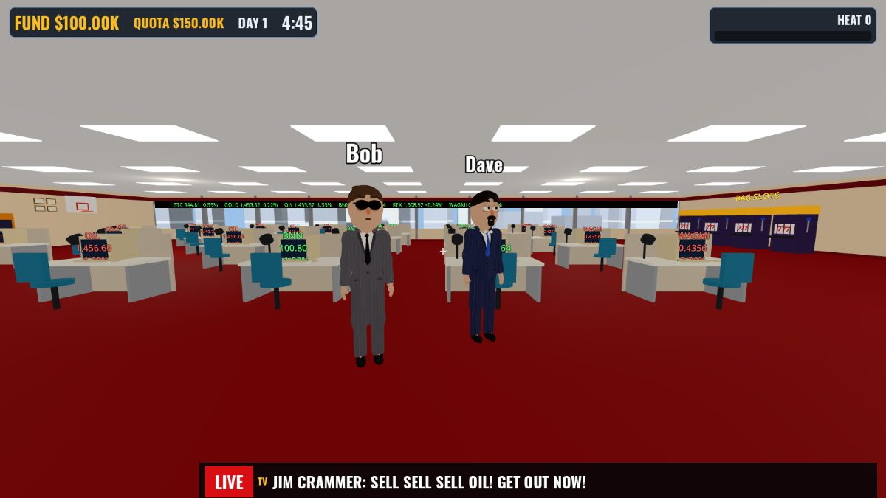 | 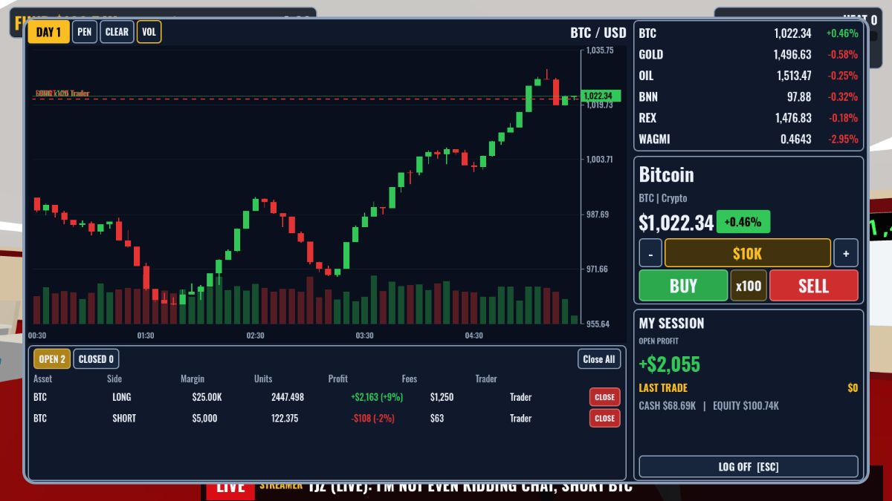 |
| 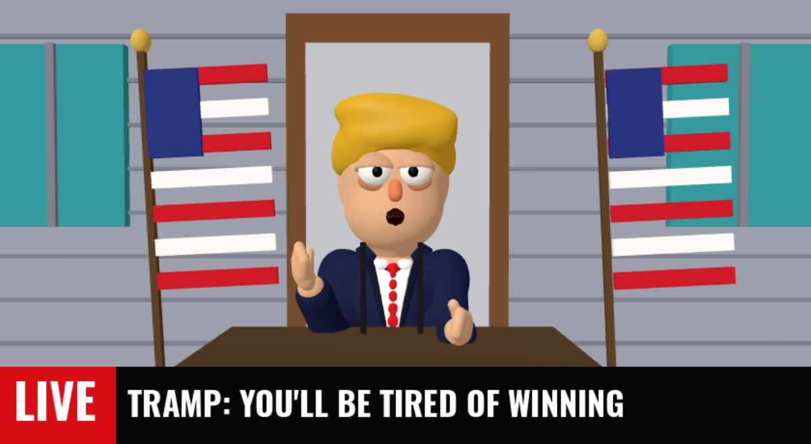 | 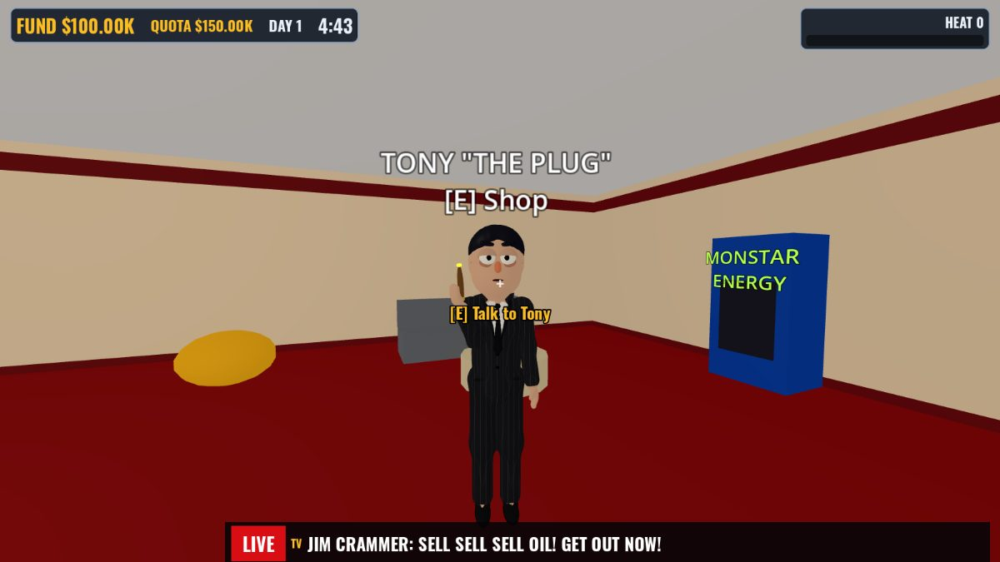 |
| 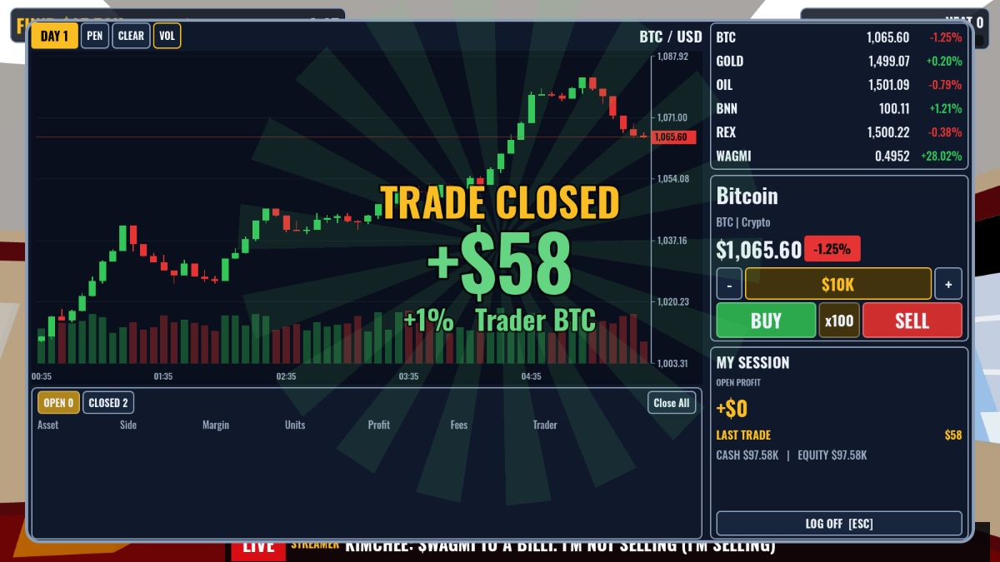 | 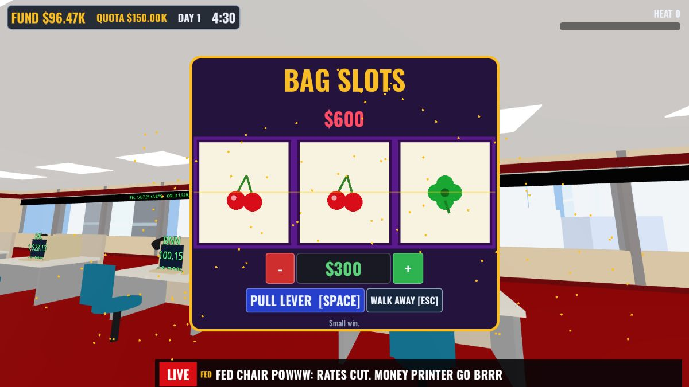 |
| 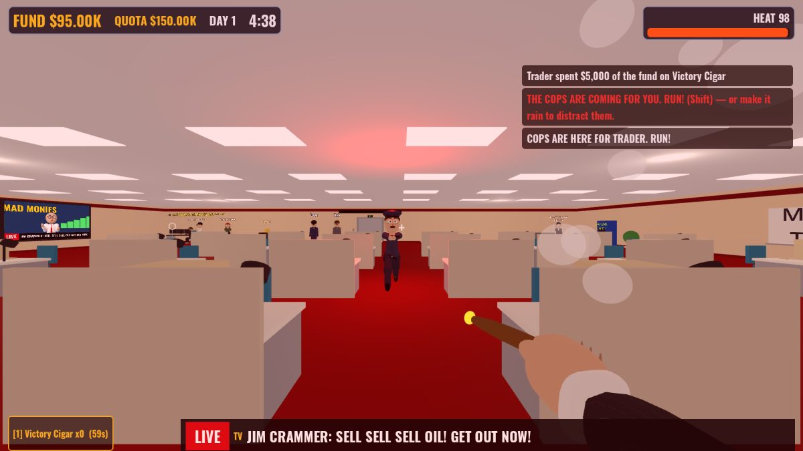 | 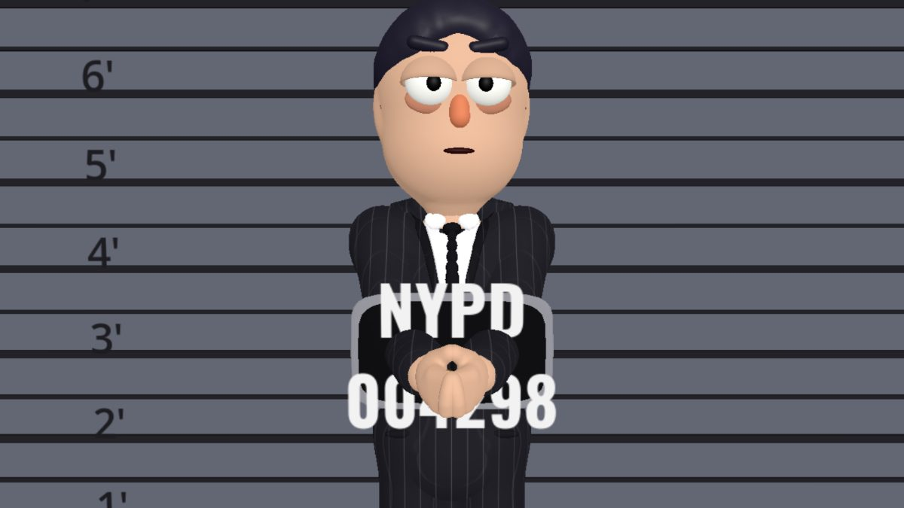 |
| 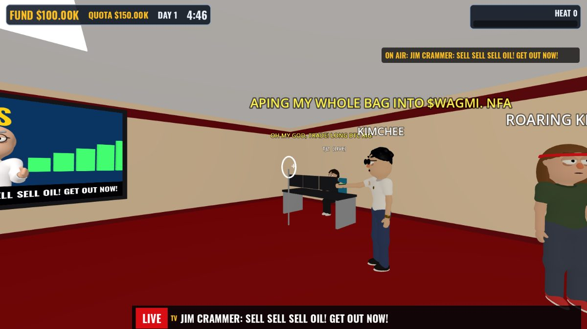 | 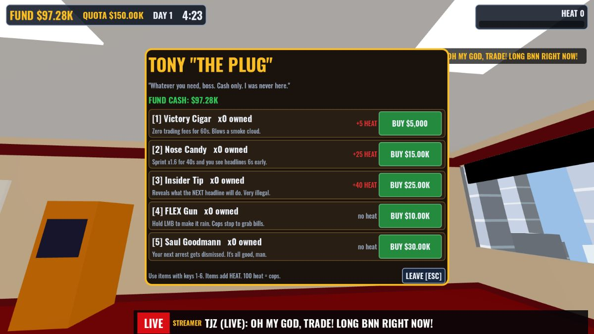 |

---

## Modes

| Mode | How it works |
|---|---|
| **Co-op** (default) | One shared fund (starts at $100K). Hit each day's quota (x1.5 every day) or the fund is busted. See how many days you survive. |
| **PvP** | Everyone gets their own $100K. Same market, same news. Miss the quota and you're out. Richest after 3 days wins. Snitching allowed. |
| **Solo** | Co-op with just you. |

## What's in the office

- **Trading terminal** at every desk, like the trailer's: candlesticks, volume, pen tool, watchlist,
  size −/+, **x1–x100 leverage**, BUY (long) / SELL (short), positions with profit and fees, MY SESSION,
  and a big **TRADE CLOSED +$120.05K** popup. Get liquidated and you lose the margin.
- **6 markets**: BTC, GOLD, OIL, BNN (Banana Corp), REX (Rex Motors), and **$WAGMI**, a memecoin that
  moves 3x as much as the rest.
- **LIVE TV + news** that moves the market (all parody):
  - **TRAMP** — "YOU'LL BE TIRED OF WINNING", tariffs, "I love Bitcoin"…
  - **TJZ** (day-trading streamer) — "OH MY GOD, TRADE! LONG BTC!" He's right about 65% of the time.
  - **KIMCHEE** (memecoin whale) — pumps $WAGMI… then usually rugs it. Sell in time.
  - **JIM CRAMMER** — "BUY BUY BUY!" Inverse him: he's wrong 75% of the time.
  - **ROARING KITTEH** — posts a cat meme and REX goes nuts.
  - **FED CHAIR POWWW** — rate cuts and hikes. Plus **BREAKING** news.
  - The streamers sit in the **streamer corner** with speech bubbles.
- **Tony "The Plug"** in the lounge sells items (keys **1–6** to use them):

  | Item | Price | Heat | What it does |
  |---|---|---|---|
  | Victory Cigar | $5K | +5 | Zero trading fees for 60s, plus a smoke cloud |
  | Nose Candy | $15K | +25 | Sprint x1.6 for 40s, and you see headlines 6s early |
  | Insider Tip | $25K | +40 | Tells you exactly what the next headline will do |
  | FLEX Gun | $10K | 0 | Hold left mouse to make it rain; cops stop to grab bills |
  | Saul Goodmann | $30K | 0 | Your next arrest gets dismissed |
  | SEC Snitch Line | $20K | 0 | PvP only: +60 heat on the richest rival |

- **Heat & cops.** Shady items and huge wins add heat. At 100 heat two cops come out of the elevator
  after you. Sprint, **dive (C / Ctrl)**, or make it rain to shake them. Survive 35s and they leave.
  If they catch you:
  - you get an **NYPD mugshot**
  - you're **fined 15%**
  - you sit in the holding cell for 20s
- **BAG SLOTS** in the casino corner: set your bet with −/+ and pull the lever. Three 7s pay 60x.
- **Characters in the trailer's style, modeled in Blender.** `tools/blender/build_characters.py`
  builds them procedurally into `assets/characters/character_kit.glb`:
  - **Base:** one skinned "stick figure" skeleton, and a smooth base body with bone-heat weights.
  - **Face (the same for everyone):** the trailer's egg head with bulging tired eyes, droopy lids,
    dark bags, an orange nose, thick brows and a thin mouth.
  - **Clothing layers:**
    - suit jacket (lapels, pockets, buttons), shirt V, cuffs, tie or long tie
    - dress shirt, cop uniform with duty belt, hoodie, tee
    - slacks, dress shoes, sneakers
  - **Hair styles:** slick, swept, swoop, short, buzz, messy, afro, long, bald.
  - **Facial hair:** mustache, goatee, full, stubble.
  - **Glasses:** shades, specs.
  - **Hats:** cop, headset, headband, beanie, cap.
  - **Accessories:** watch, ring, gold chain.
  - Clothing copies the body's weights, so it moves with the body. Every pose is driven on the bones
    (walk, blink, talk, aim, smoke, dive, cuffed and more).
- **The Tailor** (main menu): customize your trader with a live 3D preview.
  - Outfit, suit color, pinstripes, shirt, tie, pants, shoes, hair, skin tone, facial hair, glasses,
    hat, watch, chain and ring. There's also a randomize button.
  - Your look is saved and sent to everyone in the game.
- **TRAMP on the office TV** at a podium between two flags, and a **3D mugshot of your own character**
  holding the NYPD placard.
- **Basketball hoop.** Grab the ball (E), throw it (left mouse). A swish is +$1,000 to the fund.
- The rest of the office: red carpet, CRT desks, city skyline, the MONEY TALKS whiteboard, the ticker
  strip and the opening bell.

## Controls

| Key | Action |
|---|---|
| WASD / Shift / Space | Move / sprint / jump |
| C or Ctrl | Dive |
| E | Use desk terminal, slots, Tony, grab ball |
| Left mouse | Throw ball / FLEX gun |
| 1–6 | Use items |
| Tab | Scoreboard |
| T | Chat |
| Enter | (Host) ring the opening bell / back to lobby |
| Esc | Close panel / pause (mouse sensitivity is in there) |

**Terminal hotkeys:**

| Key | Action |
|---|---|
| B / S | Buy / Sell |
| Q / E | Size down / up |
| L | Cycle leverage |
| C | Close all |
| 1–6 | Switch asset |

## Play with friends

1. Everyone downloads the game for their computer (see **Get the game** below).
2. One person clicks **HOST CO-OP** (or **HOST PVP**).
3. Everyone else types the host's IP and clicks **JOIN**. The port is 7777.
   - **Same Wi-Fi / same house:** use the host's local IP, e.g. `192.168.1.23`.
     On Windows run `ipconfig`; on Mac it's in System Settings → Wi-Fi → Details.
   - **Different houses (easiest):** everyone installs **[Tailscale](https://tailscale.com)**
     (free, takes 2 minutes) and logs into the same account or tailnet. Then join with the
     host's Tailscale IP (`100.x.y.z`). No router setup needed.
   - **Different houses (advanced):** the host forwards **UDP 7777** on their router and shares
     their public IP.
4. The host presses **Enter** to ring the opening bell. Trade, gamble, run from the cops.

The first time you host, Windows Firewall will ask to allow it. Click **Allow**.

## Get the game

Every push builds the game automatically:

1. Go to the repo's **Actions** tab and open the latest **Test & Build** run.
2. Download **Bagholders-Windows**, **Bagholders-macOS** or **Bagholders-Linux** from Artifacts.
3. Unzip it and send it to your friends. For a public download link, push a tag like `v0.1`.
   That creates a GitHub Release with all three zips.

Each platform needs one extra step the first time:

- **Windows:** it's a single `Bagholders.exe`. SmartScreen may say "unrecognized app". Click
  **More info → Run anyway**. That happens because the exe isn't code-signed.
- **macOS:** grab **Bagholders-Mac-AppleSilicon** (M1/M2/M3/M4 Macs) or **Bagholders-Mac-Intel**
  (older Macs). **Bagholders-macOS** is the universal build that works on both, at twice the size.
  - Unzip it and double-click `BAGHOLDERS.app`. macOS will say it "could not verify" the app.
  - Click **Done**, then open **System Settings → Privacy & Security**, scroll down, and click
    **Open Anyway**. Do it within an hour of the warning.
  - Since macOS 15 (Sequoia), right-click → Open no longer skips this step.
  - Terminal alternative: `xattr -dr com.apple.quarantine BAGHOLDERS.app`
  - Getting rid of the warning entirely needs Apple's $99/yr developer program.
- **Linux:** run `chmod +x Bagholders.x86_64`, then `./Bagholders.x86_64`.

## Run from source / keep building it

1. Install **[Godot 4.7.2](https://godotengine.org/download)** (standard build, not .NET).
2. Open `project.godot` and press **F5**.

Everything is plain GDScript and there are no binary scenes: the level, characters and UI are all
built in code, so an AI can keep extending it.

```
scripts/
  sim/      market.gd (price model), news.gd (TRAMP/TJZ/KIMCHEE...), ledger.gd (leverage math), rules.gd (tuning)
  net/      net.gd (ENet host/join), match.gd (server-authoritative game loop), config.gd, sfx.gd
  art/      character.gd (skinned kit loader: looks, presets, bone animation), props.gd, shapes.gd, batcher.gd
  world/    world.gd, office_builder.gd (the whole level), ball.gd
  player/   player.gd (first person), cop.gd (navmesh chase AI)
  ui/       hud.gd, terminal.gd, chart.gd, slots_ui.gd, shop_ui.gd, trade_popup.gd, overlays.gd, tv_screen.gd, main_menu.gd
tests/      test_sim.gd, smoke_driver.gd (2-player end-to-end), screenshot_driver.gd, run_all.sh
tools/      blender/build_characters.py (the character kit), make_sfx.py (sound effects),
            thin_macos.py (splits the Mac build per chip)
assets/     characters/character_kit.glb, fonts/, sfx/
```

Tuning (money, quotas, heat, item prices, slot odds) lives in `scripts/sim/rules.gd`.

**Rebuilding the characters:** run `pip install bpy==4.5.14`, then
`python3 tools/blender/build_characters.py`. That takes about 10 seconds and rewrites
`character_kit.glb`. To add a new hair style or garment, add a builder function to that script, then
add the option to `OPTIONS` in `scripts/art/character.gd`.

### Tests

```bash
GODOT=/path/to/godot tests/run_all.sh
```

That runs:

- a compile check
- about 2,500 sim unit checks (the x100 leverage math matches the trailer: +1.21% move → +121%)
- a real two-instance multiplayer smoke test, once in co-op and once in PvP

The smoke test drives a full session: join, trade, buy and use an item, slots, chat, basketball,
then a cop raid, an arrest and the jail teleport. CI runs all of it on every push.

## Credits & notes

- Font: [Oswald](https://github.com/googlefonts/OswaldFont), SIL Open Font License (`assets/fonts/OFL-Oswald.txt`).
- Sound effects are synthesized by `tools/make_sfx.py`. No samples are used.
- Every person, brand and event in the game is **parody / fiction**. Nothing in it is financial
  advice. There's no real money anywhere.
