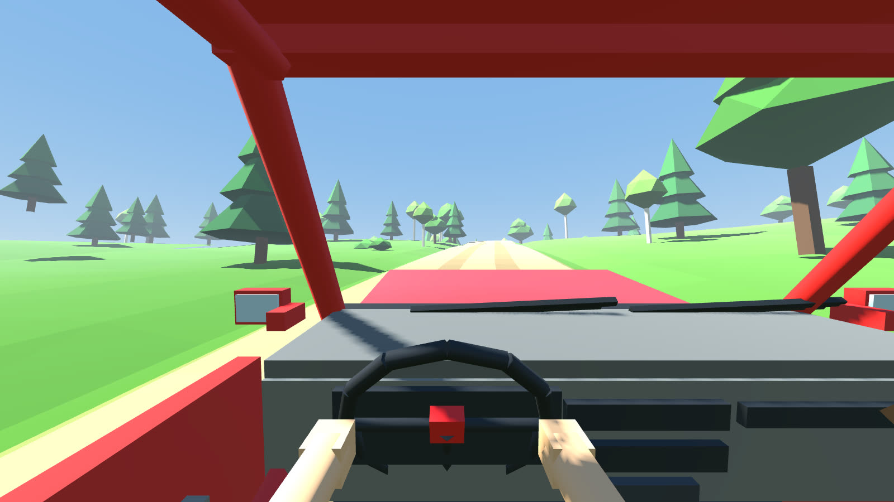
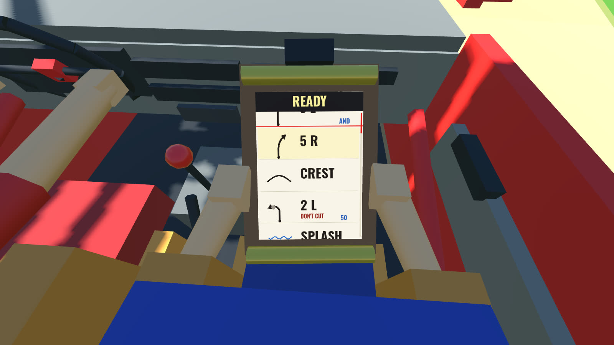
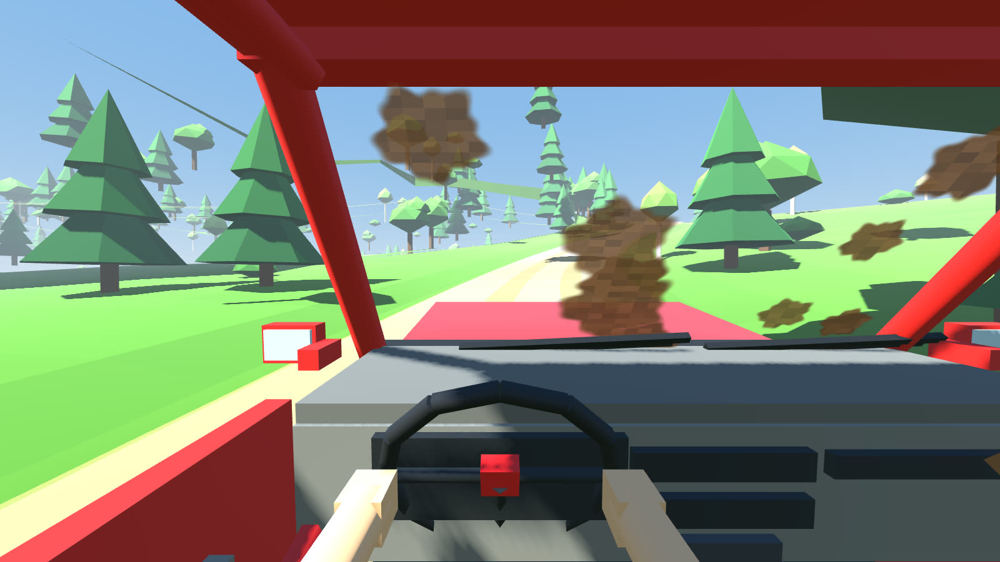
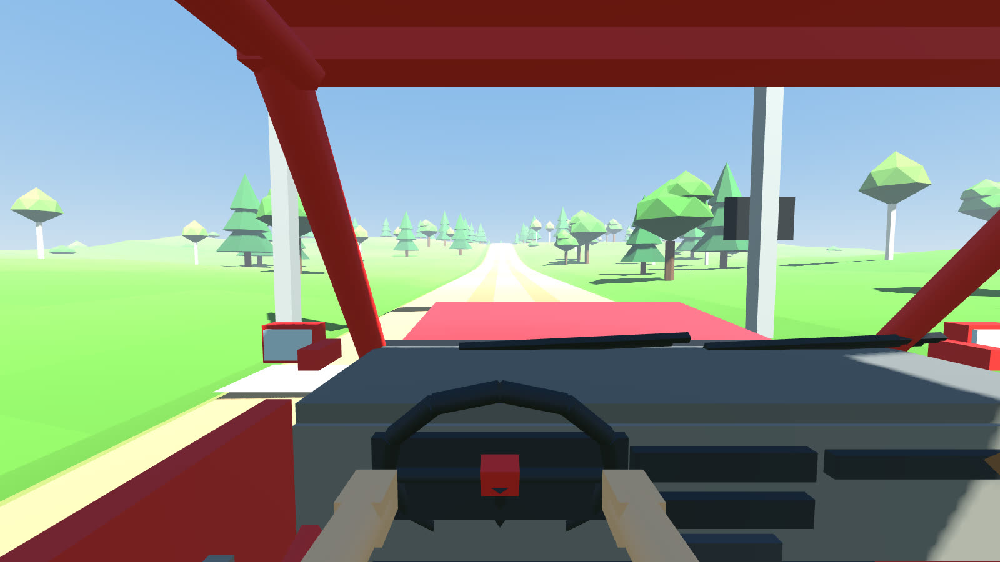

# SHOTGUN RALLY

**You drive. Your friend rides shotgun with the notes.** A cartoony 2-player online co-op rally
game. One of you drives, blind past the next crest. The other sits in the passenger seat with the
roadbook and yells the road at you: "4 LEFT! DON'T CUT! OVER CREST!" No friend online? The **AI
co-driver** takes the seat.

> This is the rally game's own branch (`shotgun-rally`) in the BAGHOLDERS repo. Nothing here touches
> the trading game on `main`.

| | |
|---|---|
|  |  |
|  |  |

## ⬇ Download (always the newest build)

The links never change. Every push to this branch replaces the files behind them (same as BAGHOLDERS):

- **Mac:** [ShotgunRally.zip](https://github.com/pbelfand-dot/Stock-multiplay-game/releases/download/shotgun-latest/ShotgunRally.zip)
- **Mac (older Intel, pre-2020):** [ShotgunRally-Intel.zip](https://github.com/pbelfand-dot/Stock-multiplay-game/releases/download/shotgun-latest/ShotgunRally-Intel.zip)
- Windows: [ShotgunRally-Windows.zip](https://github.com/pbelfand-dot/Stock-multiplay-game/releases/download/shotgun-latest/ShotgunRally-Windows.zip) · Linux: [ShotgunRally-Linux.zip](https://github.com/pbelfand-dot/Stock-multiplay-game/releases/download/shotgun-latest/ShotgunRally-Linux.zip)
- All of them on one page: [releases/shotgun-latest](https://github.com/pbelfand-dot/Stock-multiplay-game/releases/tag/shotgun-latest)
- **itch.io:** set-up steps in [`docs/ITCH.md`](docs/ITCH.md)

> While this repo is **private**, the links only work for people with access to it.

The first time you open it:
- **Mac:** unzip, double-click `SHOTGUN RALLY.app`. macOS will say it "could not verify" the app:
  open **System Settings → Privacy & Security** and click **Open Anyway**.
- **Windows:** SmartScreen may say "unrecognized app". Click **More info → Run anyway**.
- **Linux:** run `chmod +x ShotgunRally.x86_64`, then `./ShotgunRally.x86_64`.

Free, PC only (Windows, Mac, Linux). Built in **Godot 4.7**, like BAGHOLDERS.

## How a stage plays

| | Driver | Co-driver (shotgun) |
|---|---|---|
| Sees | The road through the windshield. **No map, no minimap, no HUD.** Trees crowd the inside of every bend, crests hide what's next | The **roadbook roll** in their lap, *or* the road if they look up. Never both at once |
| Does | Steers, brakes, handbrakes, trusts | Counts down the start (the start clock is on their side), calls every corner, works the **wipers** when a puddle splashes mud over the glass |
| Alone? | The **AI co-driver** calls the stage in the "Fraser" voice, early enough that you hear it all before the corner | — |

1. **Start line.** The host presses ENTER and the 5-second countdown starts. Moving off early is a
   **jump start: +10 s**.
2. **The stage** is ~2.7 km of forest gravel: corners graded 6 (nearly flat) to 1 (very slow) plus
   hairpins, corners that tighten or open, crests, jumps, puddles and rocks on the inside of the
   "don't cut" corners. Every stage is generated from a number, so there's always a new one.
3. **The roadbook roll** (our own design, not the reference's tablet) shows each note as a hand-drawn
   arrow + the call: `4 L · TIGHTENS 3 · AND`, `2 L · DON'T CUT`, `CREST · 100`. The current note sits
   under the red line, and the stopwatch is clipped on top.
4. Stuck? **R** puts the car back on the road (**+5 s**).
5. **Flying finish**, results, then the host picks: next stage, retry, or swap seats.

## Controls

| | Keyboard / mouse | Controller |
|---|---|---|
| Steer | A / D, ← / → | left stick |
| Gas / brake (hold brake when stopped = reverse) | W / S, ↑ / ↓ | RT / LT |
| Handbrake | SPACE | B / X |
| **Co-driver:** read the roadbook | hold RIGHT MOUSE or Q | hold LT |
| **Co-driver:** wipers (the driver's job when alone) | F | A |
| Look around | mouse | right stick |
| Reset car (+5 s) | R | Y |
| Start / next stage (host) | ENTER | START |
| Pause | ESC | BACK |

## Play with friends

1. One person clicks **HOST · I DRIVE** or **HOST · I RIDE SHOTGUN**. The other seat is the friend's.
2. The friend types the host's IP and clicks **JOIN**. The port is 7777.
   - **Same Wi-Fi / same house:** the host's local IP (shown on the host's screen while it waits).
   - **Different houses (easiest):** both install **[Tailscale](https://tailscale.com)** (free) and
     join with the host's `100.x.y.z` address. No router setup.
   - **Different houses (advanced):** the host forwards **UDP 7777** on their router.
3. Use Discord (or any voice chat) to talk. Yelling is the game.

The driver's computer runs the car and streams it to the co-driver ~30 times a second; the
co-driver's screen plays it back 0.1 s behind, smoothly, so the passenger seat never jitters.

## Based on *Left Left Left!*

Inspired by ***Left Left Left!*** ([@leftleftleftgame on TikTok](https://www.tiktok.com/@leftleftleftgame)):
two players in one car, both in first person, one with the map. The breakdown of the four reference
clips is in [`docs/VIDEO_BREAKDOWN.md`](docs/VIDEO_BREAKDOWN.md).

What's ours: the name and look, **our own map device** (a paper roadbook roll), **the real
co-driver's jobs** ([`docs/CO_DRIVER_JOBS.md`](docs/CO_DRIVER_JOBS.md)), and an **AI co-driver** with a
real voice.

## Roadmap

| Phase | What | Status |
|---|---|---|
| 0 | Reference breakdown, name, plan, co-driver research, voice pack | ✅ done |
| 1 | **Playable grey box:** generated forest gravel stages, raycast rally car, first-person driver + co-driver seats, roadbook roll, mud + wipers, start countdown, jump starts, resets, results, 2 players online, builds | ✅ done |
| 2 | **AI co-driver** | ✅ basic version done (calls by time, countdown, finish). Next: quick-call wheel for the human co-driver, call-timing setting in the menu, more lines |
| 3 | **Art:** low-poly car and cockpit (Blender scripts + Higgsfield), better trees, helmets and arms | next |
| 4 | **Jobs + content:** OK board, warning triangle, pushing the car, punctures, time cards, road book, recce mode, more biomes | |
| 5 | Polish, crews racing each other | |

## Run from source / keep building it

1. Install **Godot 4.7** (free) and open this folder, or run `godot --path .`.
2. Tests (headless, ~3 minutes): `GODOT=/path/to/godot tests/run_all.sh`
   - compiles every script; checks 20 generated stages (deterministic, never crossing themselves,
     every corner gets a note)
   - the autopilot drives whole stages: 0–100 km/h on gravel (4.8 s), braking, the handbrake flick
   - the AI co-driver says every call in time (90–240 m before the corner)
   - **2 players, both ways round:** one machine drives, the other rides along; both see the finish
3. Screenshots without a screen: `xvfb-run godot --path . -- --seed=11 --screenshot=out.png --shot_seat=codriver --shot_read`

| Folder | What's in it |
|---|---|
| `scripts/stage/` | the stage generator, the pacenotes, the world builder |
| `scripts/vehicle/` | the rally car, cockpit + crew, roadbook roll, seat camera, AI co-driver, autopilot |
| `scripts/net/` | settings, the input map, the 2-player connection |
| `assets/voice/fraser/` | the co-driver voice clips (new lines: [`assets/voice/fraser/README.md`](assets/voice/fraser/README.md)) |
| `tests/` | the headless tests |
| `docs/` | the plan, the reference breakdown, co-driver research, itch.io set-up |

## Credits & notes

- Co-driver voice: Higgsfield Seed Audio 1.0, preset voice "Fraser", made for the Rally Co-Driver
  GPS app ([driver-test-app](https://github.com/pbelfand-dot/driver-test-app)).
- Sound effects are synthesized (`tools/make_sfx.py`, plus BAGHOLDERS' engine / crash / bell sounds,
  also synthesized). No samples.
- Font: [Oswald](https://github.com/googlefonts/OswaldFont), SIL Open Font License (`assets/fonts/OFL-Oswald.txt`).
- *Left Left Left!* belongs to its creator. We borrow the idea of the game, not their art, name or UI.
